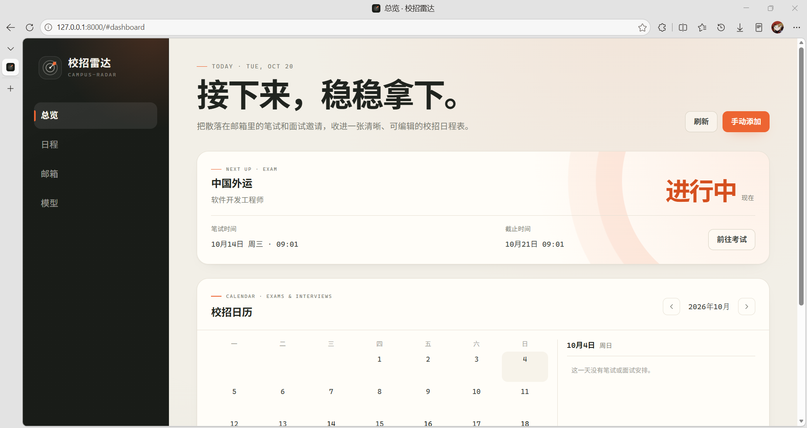

<div align="center">
  <h2>📡 校招雷达 — Campus Radar</h2>
  <p>从招聘邮箱自动整理笔试与面试安排的本地校招日程工具</p>
</div>

<p align="center">
  
  
  
  
</p>

通过 IMAP 只读连接招聘邮箱，识别笔试、测评与面试邮件，提取公司、岗位、时间、面试轮次、截止确认、平台、入口链接和会议信息，整理成校招日历和可按类型筛选的日程清单。默认完全本地处理；配置 API Key 后可接入 OpenAI 兼容大模型，提升非标准邮件的识别率。

---

## 功能

|          |                                        |
|----------|----------------------------------------|
| **邮箱同步** | 只读连接 QQ、网易 163、网易 126、Gmail 或自定义 IMAP，按 UID 增量检查 |
| **同步范围** | 每张邮箱卡片可单独调整最近 7 / 14 / 30 / 60 / 90 天 |
| **笔试与面试识别** | 区分笔试 / 测评邀请、面试邀请与提醒，过滤宣讲会、成绩、拒信、感谢信、投递成功、Offer、问卷、面经和招聘广告 |
| **关键信息抽取** | 公司、岗位、时间、面试轮次、截止确认、平台、链接、会议号、密码和地点 |
| **提醒合并** | 同一场笔试或面试的邀请与提醒合并，改期邮件更新原记录 |
| **日程看板** | 下一场安排、校招日历和当天安排，一屏查看 |
| **类型筛选** | 按全部 / 笔试 / 面试筛选，按待参加 / 待确认 / 已结束 / 已完成 / 已忽略分组 |
| **手动修正** | 所有字段可编辑，状态分为待参加、已完成、已忽略，支持删除；手动添加时可选择类型 |
| **清空邮箱数据** | 保留邮箱连接，一键删除该邮箱同步的全部日程和识别记录；可选择重置同步游标，让下次同步重新导入旧邮件 |
| **无明确时间** | 只要求“尽快完成”时，按收件时间匹配 09:00 / 14:00 / 19:00 的建议时间；明确“收到后 N 个自然日内完成”时，开始时间取收件时间，并标记为待确认 |
| **大模型识别** | 填写 API Key 后，大模型先判断邮件是否包含有效安排，再抽取字段；营销、结果通知和问卷可直接否决 |
| **本地优先** | 邮件、密钥和数据保存在本机，默认不向云端发送邮件内容 |

## 截图



## 快速开始

### Windows

双击 `start.bat`，首次运行会自动创建 `.venv` 并安装依赖：

```text
http://127.0.0.1:8000
```

### macOS / Linux

```bash
bash start.sh
```

### 手动启动

要求 Python 3.10 或更高版本。

```bash
git clone https://github.com/vivi2048/campus-radar.git
cd campus-radar
python -m venv .venv
# Windows: .venv\Scripts\activate
# macOS/Linux: source .venv/bin/activate
pip install -r requirements.txt
python run.py
```

## 使用

1. 在「邮箱」页面填写邮箱地址，系统会根据域名自动识别服务商，并提示对应的授权码获取方式。
2. 首次同步默认检查最近 7 天的最多 300 封邮件。
3. 在「日程」中查看识别结果，处理「待确认」记录。
4. 需要检查新邮件时，点击邮箱卡片上的「同步」，也可以等待后台定时同步。
5. 需要清空某个邮箱的识别结果时，点击卡片上的「清空邮件」，并可勾选是否重置同步游标；邮箱连接和原始邮件不受影响。
6. 点击邮箱卡片右上角的设置按钮，可以调整同步范围；需要立即按新范围重读旧邮件时，可清空邮件并勾选重置同步游标。

> 这里需要的是邮箱服务商生成的授权码 / 应用专用密码，通常不是网页登录密码。

## 大模型识别（可选）

默认使用本地规则。填写 API Key、接口地址和模型名称并保存后，系统会先让大模型判断邮件是否包含可执行的笔试/面试安排；判断为营销、结果通知、问卷或招聘资讯时不会创建日程。未填写 Key 或调用失败时回退本地规则。

| 配置 | 说明 |
| --- | --- |
| 接口地址 | OpenAI 兼容的 Chat Completions 地址，例如 `https://api.deepseek.com/v1` 或 `https://api.openai.com/v1` |
| 模型名称 | 例如 `deepseek-chat`、`gpt-4o-mini` 或本地模型名称 |
| API Key | 加密保存在本机；清除后恢复为纯本地规则 |
| 单次识别上限 | 每次同步最多调用大模型的次数，默认 20 |
| 识别并发数 | 同一邮箱同步内并行发起的 AI 请求数，默认 4，可调 1–10；调高可加快批量解析，但可能触发接口限流 |

> DeepSeek 请使用 `https://api.deepseek.com/v1`，不要填写 `/anthropic` 路径。本地 Ollama 可填 `http://127.0.0.1:11434/v1`，并填写一个占位 Key。

AI 生成的记录会进入待确认。时间会尽量依据模型给出的邮件原文片段重新解析；缺少原文证据时会提示重点核对。只有通过招聘关键词初筛的邮件会发送到你配置的接口，邮箱授权码不会发送。

同步时邮件仍按顺序从 IMAP 读取，但 AI 请求会按配置的并发数并行发出；识别结果仍按邮件从新到旧的顺序写库，保证合并与去重行为不变。

## 技术栈

**Python 3.10+** · **FastAPI** · **SQLite** · **Vanilla JS** · **IMAP** · **Fernet** · **OpenAI-compatible LLM**

| 层级 | 技术 |
| --- | --- |
| Web 服务 | FastAPI + Uvicorn |
| 数据存储 | SQLite（WAL），授权码与 API Key Fernet 加密 |
| 邮件接入 | IMAP over SSL，只读、UID 增量同步 |
| 识别流程 | 本地规则 + 正则，可选大模型结构化抽取 |
| 前端 | 无构建步骤的原生 HTML / CSS / JavaScript |

## 项目结构

```text
campus-radar/
├── app/
│   ├── main.py               # FastAPI 接口与静态站点
│   ├── db.py                 # SQLite 表结构与迁移
│   ├── llm.py                # 可选大模型识别与配置
│   ├── mail/                 # IMAP、MIME 与邮箱服务商配置
│   ├── extract/              # 分类、时间解析、字段抽取
│   └── services/             # 同步、事件、账户
├── static/                   # 无构建步骤的前端看板
├── screenshots/              # README 截图
├── tests/                    # 接口、同步、抽取与 AI 测试
├── data/                     # 本地数据库、密钥和日志（不提交）
├── run.py
├── start.bat / start.sh
└── requirements*.txt
```

## 数据与隐私

- 应用默认只监听 `127.0.0.1`，没有登录验证，请勿直接暴露到公网。
- 邮箱使用 IMAP 只读访问，不会标记已读、发送、修改或删除邮件。
- 只有被识别为笔试或面试相关的邮件正文保存在本地 SQLite；扫描过的其他邮件只保留去重指纹。
- 授权码和可选的 API Key 使用 Fernet 加密保存：
  - 数据库：`data/campus-radar.db`
  - 本地密钥：`data/.secret.key`
  - 日志：`data/campus-radar.log`
- 默认不向任何云端服务发送邮件内容。配置大模型 API Key 后，只有通过招聘关键词初筛的邮件会将主题、正文和链接发送到所配置的接口。
- 删除 `data/` 会清空全部本地记录；删除 `.secret.key` 后需要重新输入授权码和 API Key。

## 可选配置

| 环境变量 | 默认值 | 说明 |
| --- | --- | --- |
| `CAMPUS_RADAR_DATA_DIR` | `./data` | 数据库、密钥和日志目录 |
| `CAMPUS_RADAR_HOST` | `127.0.0.1` | 监听地址 |
| `CAMPUS_RADAR_PORT` | `8000` | 监听端口 |
| `CAMPUS_RADAR_AUTO_SYNC_MINUTES` | `30` | 自动同步间隔（最小 5 分钟） |
| `CAMPUS_RADAR_SECRET_KEY` | 空 | 自定义加密口令，设置后需保持一致 |
| `CAMPUS_RADAR_DISABLE_SCHEDULER` | 空 | 设为 `1` 关闭后台自动同步 |
| `CAMPUS_RADAR_NO_BROWSER` | 空 | 设为 `1` 启动后不打开浏览器 |

旧的 `EXAM_RADAR_*` 和 `EXAMHELPER_*` 变量仍兼容读取。

## 识别范围与已知限制

- 时间按北京时间（Asia/Shanghai）理解和显示，海外安排需自行核对时区。
- 首次同步最多处理最近 300 封邮件；只同步一个文件夹（默认 `INBOX`）。
- 邮件附件不会被解析；纯图片或附件中的安排需要手动补充。
- 自动同步仅在应用运行时执行，不是系统后台服务。
- 大模型可能误判或遗漏，AI 生成的记录需要人工确认。
- “尽快完成 / 几天内完成”这类邮件给出的时间是系统按收件时间推算的建议值，会标记为待确认，请自行调整。
- 邮件同时提到“另一封邀请邮件”和“收到后 N 小时内完成”时，系统仍会按收件时间推算截止时间并标记待确认，请核对时限是否适用于本场安排。
- 无法同步已归档或移出收件箱的邮件。

## 开发与测试

```bash
pip install -r requirements-dev.txt
python -m pytest
```

测试覆盖中文 / 英文笔试与面试邮件、时间解析、改期合并、提醒去重、重新识别、大模型识别、本地规则补全与失败回退，以及 API CRUD，当前共 101 个测试。

## 贡献

欢迎提交 Issue 和 Pull Request。

## 许可证

[MIT License](LICENSE)

---

<sub>本项目仅供学习交流，与任何招聘机构无关。请自行核对邮件、考试与面试信息。</sub>
